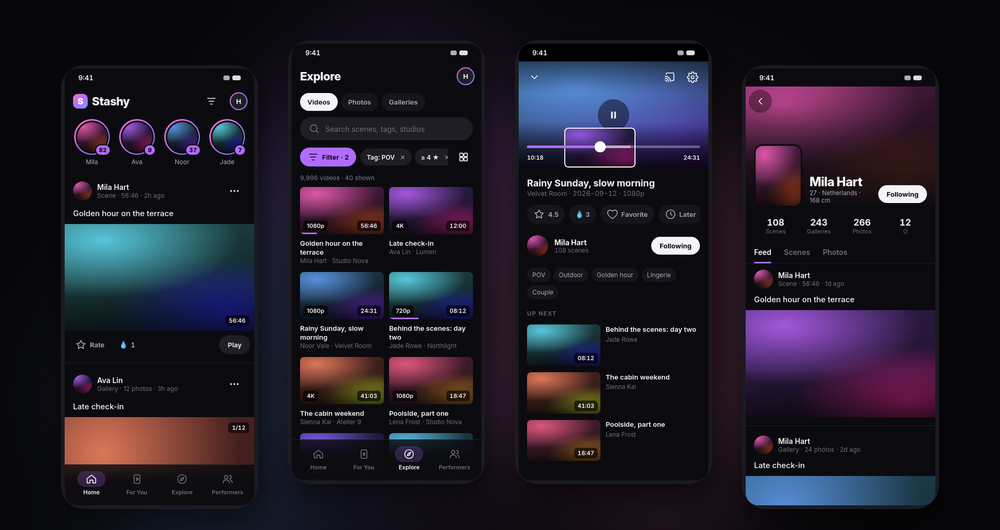
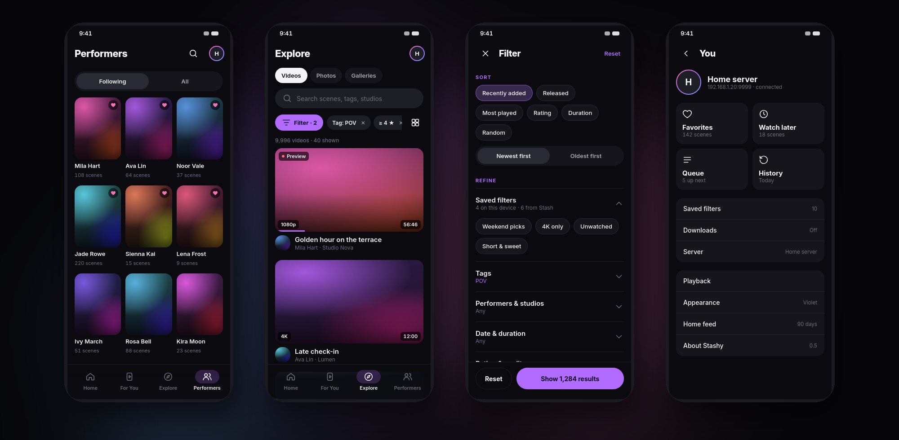

<div align="center">


# Stashy

### A premium Android app for your Stash server.

A social-style feed, a For You reel, performer profiles and a smooth player, all running against the
[Stash](https://stashapp.cc) server you already host. Native Kotlin and Jetpack Compose, one dark design, no cloud.

<p>
  
  
  
</p>



<sub>Previews use placeholder artwork. Stashy ships no media; everything you see comes from your own server.</sub>

</div>

---

## What it does

Stash is a great server for organising a private media library. Stashy is the phone side of it: quick to
browse with one hand, built around your library's performers, and pleasant to just scroll through.

### Home: a feed of what's new

- **Stories** for every performer with new scenes, like on Instagram.
- **One post per video**, shown in its own shape: portrait stays portrait, landscape stays landscape.
- **Videos play right in the feed**, muted by default. Turn the sound on once and it stays on for the session.
  Tap a video to pause it; **Open** takes you to the full player.
- **Gallery posts** you swipe through photo by photo, with a fullscreen viewer.
- **Seen posts** move below a "You're all caught up" line and sync through your Stash server, so every device
  knows what you've already seen.

### For You: a full-screen reel

Vertical swiping through your library, **Random** or **Chained** (each next scene shares tags or performers with
the one before), with rating, O counter and favorites right on the video.

### Explore: videos, photos and galleries

- Search plus **one fullscreen filter**: sort, tags, performers and studios, date and duration, rating and quality.
  Every section shows the live result count before you apply it.
- **Your saved filters from the Stash web UI**, including its default filter.
- **Compact or Large layout**. Large plays the centred card's preview on its own; in Compact, touch and hold a card.
- The header folds into a slim search bar as you scroll, and comes back when you scroll up.

### Performers

Following and All, sorting, and a profile per performer: a hero header, a feed of their new scenes and galleries,
and their scenes and photos in Compact or Large grids. Follow and unfollow writes straight back to Stash.

### The player

- **Mini player**: swipe down or press back, and the video keeps playing above the tab bar while you browse.
- **Seek previews** from Stash's sprite images while you drag; the video jumps once, exactly where you let go.
- Double-tap ±10 s, gestures for brightness and volume, speed hold, subtitles, picture-in-picture and background
  playback.
- Rating, O counter, favorites, watch later and queue on the watch page.

### Design

One dark design built for media: Inter typography, layered near-black surfaces, shared-element transitions from
thumbnails and performer photos, predictive back, spring motion and loading placeholders instead of spinners.
Pick one of five accent colours or let Android take it from your wallpaper.



## Requirements

- Android 10 or newer.
- A Stash server your phone can reach: on your LAN, over a VPN or Tailscale, or behind your own HTTPS reverse
  proxy. A recent Stash version (0.27 or newer) is recommended; saved and default filters come from its UI settings.
- One way to sign in: no authentication on a trusted local server, a Stash **API key**, or your Stash **username
  and password**.
- Optional: generated **previews** and **sprites** in Stash (Tasks → Generate) make card previews and seek previews
  nicer. Without them, Stashy falls back to a short muted loop of the video itself and to a time-only seek bubble.

## Install

Builds will be published on the [Releases](../../releases) page. Download the APK on your phone, open it, and allow
installs from your browser or file manager if Android asks.

To build it yourself:

```bash
./gradlew :app:assembleRelease
```

You need JDK 21 and the Android SDK (compile SDK 36). More in [DEVELOPMENT.md](DEVELOPMENT.md).

## First connection

On first launch, enter your server address (for example `http://192.168.1.20:9999` or your own HTTPS address),
choose how to sign in and tap **Test connection**. Once it works, Stashy opens Home.

## Privacy

Stashy talks only to your Stash server. There is no account, no analytics and no third-party service.

- Server settings, API keys, session cookies and on-device lists stay on the phone.
- The list of seen feed posts is stored in your Stash server's UI settings, under the `stashy` key.
- An option hides the app preview in Android's recent apps, and an optional app lock uses your device's
  fingerprint or screen lock.

## Credits

- Stashy grew out of [**stash-player-android**](https://github.com/gomeng-dev/stash-player-android) by gomeng-dev,
  which it extends with the feed, reel, performer and design work described above.
- Feed, stories and the For You reel follow the ideas of the [**Binge**](https://github.com/ordureconnoisseur/binge)
  Stash plugin.
- [**Inter**](https://rsms.me/inter/) by Rasmus Andersson, under the SIL Open Font License
  ([license](app/src/main/assets/licenses/inter-OFL.txt)).
- Built with Jetpack Compose, Media3/ExoPlayer, Coil, Room and OkHttp.

Stashy is an independent project and is not affiliated with Stash or its developers. It contains no media of its
own; what it shows depends entirely on your library. If your library contains adult content, keep the app and its
screenshots away from minors and out of public places.

## License

MIT. See [LICENSE](LICENSE). The original stash-player-android copyright notice is kept, as the license requires.
